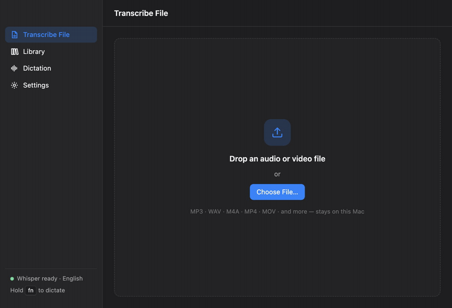
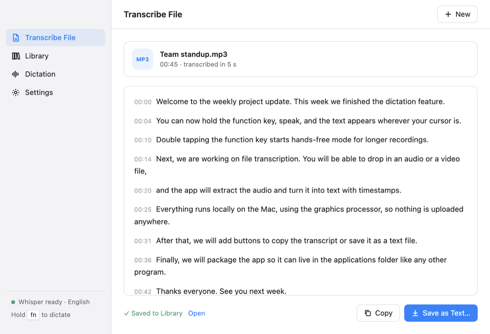
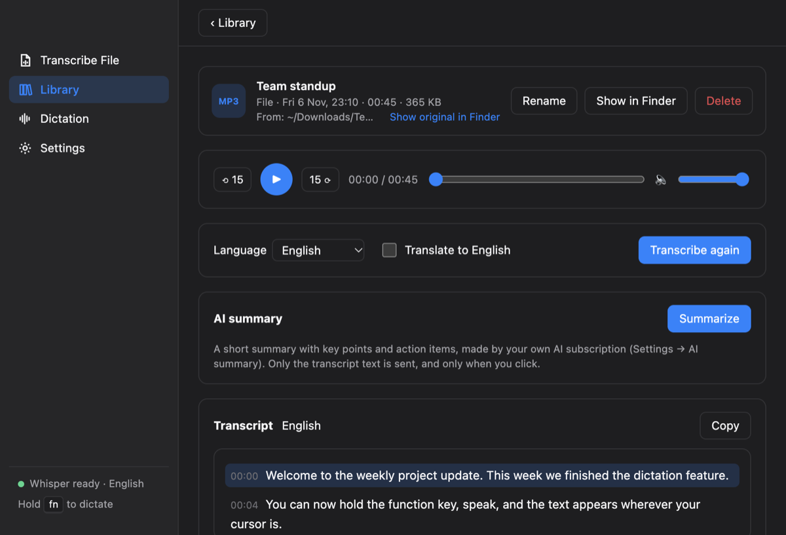

<div align="center">


# L - Whisper

**Dictate, transcribe and record meetings on your Mac — 100% locally, with OpenAI's Whisper.**

No account. No subscription. No audio ever leaves your Mac.

[](LICENSE)
[](https://github.com/dologics/l-whisper/actions/workflows/ci.yml)
[](https://github.com/dologics/l-whisper/releases)


[Download](https://github.com/dologics/l-whisper/releases/latest) · [Features](#features) · [Privacy](#privacy) · [Build from source](#build-from-source) · [Contributing](CONTRIBUTING.md) · [Work with me](#work-with-me)

</div>

<p align="center">
  
</p>

<p align="center">
  
  
</p>

---

## Why L - Whisper?

Most speech-to-text tools do one thing, or send your voice to a server. L - Whisper puts everything in one
small menu bar app that runs **entirely on your Mac**:

- 🎙️ **Dictation anywhere** — hold a key, speak, and the text appears where your cursor is.
- 📄 **File transcription** — drop an audio or video file, get a timestamped transcript.
- 🧑‍🤝‍🧑 **Meeting recording** — your mic **and** the other people (Zoom, Meet in Chrome, WhatsApp, anything).
- 📚 **Library** — all meetings and transcripts in one place, with a player and txt / srt / vtt export.
- ✨ **AI summary (optional)** — summarize a transcript with the Claude Code or Codex you already use. No API key.

Everything it needs (whisper.cpp, FFmpeg) is **bundled** — no Homebrew, no Python, no terminal.

## Features

### 1. Dictation
- Hold the **dictation key** (Fn, or two modifiers like ⌃⌥ — your choice) → speak → release. The text is
  pasted into whatever app has the cursor; your clipboard is restored afterwards.
- **Double-tap** for hands-free mode, tap again to stop.
- Silence is ignored, so no made-up text.

### 2. File transcription
- Drag in any audio or video file (mp3, wav, m4a, mp4, mov, …).
- Live progress, timestamped transcript, Copy / Save. The transcript is saved to the Library automatically;
  your original file is never copied or moved.

### 3. Meeting recording (audio only)
- Menu bar → **Start Meeting Recording**. Records your microphone plus everything your Mac plays.
- Saved while recording (crash-safe), about 29 MB per hour, in `~/Documents/L - Whisper Library/`.

### 4. Library
- Meetings and transcribed files in one list, newest first.
- Built-in player; click a transcript line to jump there.
- Transcribe in **Auto / English / Urdu**, optionally translate to English → `.txt`, `.srt`, `.vtt`.
- Rename, delete (to Trash), show in Finder.

### 5. AI summary (optional, off by default)
- Settings → AI summary → choose **Claude Code** or **Codex** (whichever you have installed and signed in to).
- Click **Summarize** on a Library item → Summary, Key points, Action items, Open questions →
  saved as `<name>.summary.md` next to the transcript.

### Models
Choose a Whisper model in the first-run setup or Settings → Models: Tiny, Base, Small, Medium,
Large v3 Turbo (compact) and Large v3 Turbo. Bigger is more accurate, smaller is faster.

## Privacy

L - Whisper is local-first by design:

| What | Where it goes |
|---|---|
| Your voice, recordings, files, transcripts | **Stay on your Mac.** Never uploaded. |
| Whisper model files | Downloaded once, on your request, from the official whisper.cpp repository on Hugging Face. |
| AI summary | **Only when you click Summarize** (or Test), the transcript **text** — never audio — is given to the AI tool *you* chose (Claude Code or Codex, your own subscription). Off by default. |

Nothing else touches the network. No analytics, no telemetry, no account.

## Install

1. Download the DMG for your Mac from [Releases](https://github.com/dologics/l-whisper/releases/latest):
   - **Apple Silicon** (M1, M2, M3, M4…) → `L-Whisper-<version>-arm64.dmg`
   - **Intel** → `L-Whisper-<version>-x64.dmg`
   *(Not sure? Apple menu → About This Mac → "Chip".)*
2. Open the DMG and drag **L - Whisper** to **Applications**.
3. **First launch:** the app is not notarized by Apple, so macOS will block it once.
   Open it, then go to **System Settings → Privacy & Security** → scroll down → **Open Anyway**.
4. Follow the first-run setup: permissions → dictation key → download a model → try it.

**Requirements:** macOS 14.2 (Sonoma) or later. Apple Silicon is fastest (GPU via Metal); Intel works on the CPU.

### Permissions — and why

| Permission | Why |
|---|---|
| Microphone | To hear your voice while you dictate or record a meeting |
| Input Monitoring | To notice when you hold the dictation key |
| Accessibility | To paste the text into the app you're using |
| System audio recording | To record the other people in a meeting (asked when you first record one) |

## Build from source

**You need:** macOS 14.2+, Xcode Command Line Tools (`xcode-select --install`), Node.js 22 or newer (tested with 24) and npm,
git and cmake (e.g. `brew install cmake`).

```bash
git clone https://github.com/dologics/l-whisper.git
cd l-whisper
npm install
npm run build:native   # Swift helpers (dictation key + paste, meeting recorder) — ~1 min
npm run build:tools    # whisper.cpp + FFmpeg for both chips — ~8 min the first time
npm start              # build and run in development mode
```

In development the app uses the models in `models/` and the programs in `bin/`. Download a model in the
app's first-run setup.

Run the checks:

```bash
npm run typecheck && npm run lint && npm test
```

Making your own installable build (`npm run install-app` / `npm run release`) needs a code-signing
certificate — see [CONTRIBUTING.md](CONTRIBUTING.md#signing).

## How it works

An Electron menu bar app (strict TypeScript) that runs a local **whisper.cpp** server, two small Swift
helpers (dictation key + paste, meeting audio capture) and **FFmpeg** for audio. The full tour — processes,
file map, flows and the reasons behind each decision — is in [`docs/ARCHITECTURE.md`](docs/ARCHITECTURE.md).
Known traps are collected in [`docs/GOTCHAS.md`](docs/GOTCHAS.md).

```
src/main/       app logic: dictation, transcription, meetings, Library, models, AI summary
src/renderer/   the main window (Transcribe, Library, Settings, first-run setup)
src/recorder/   hidden window that records dictation audio
native/         Swift helpers (fn-listener, meeting-recorder)
scripts/        build, sign, install and release scripts
test/           unit tests
```

## Roadmap

Ideas we'd like to explore — contributions welcome:

- Speaker labels (You / Others, then Speaker 1, 2, 3)
- Custom vocabulary for names and jargon
- Keep dictation history across restarts (opt-in)
- More languages in the language menu
- Windows and Linux versions

See [open issues](https://github.com/dologics/l-whisper/issues) and the [changelog](CHANGELOG.md).

## Contributing

Bug reports, ideas and pull requests are welcome — start with [CONTRIBUTING.md](CONTRIBUTING.md).
Questions and ideas: [Discussions](https://github.com/dologics/l-whisper/discussions).
Please follow the [Code of Conduct](CODE_OF_CONDUCT.md). Security issues: see [SECURITY.md](SECURITY.md).

## Work with me

I'm Mohsin Shoaib, and I build L - Whisper. If you'd like a custom version for your team, an
integration, help with a speech-to-text or AI project, or you just want to collaborate, get in touch:

📧 **[mianmitho@gmail.com](mailto:mianmitho@gmail.com)** · GitHub [mohsin917](https://github.com/mohsin917)

(Bugs and feature ideas are best as [issues](https://github.com/dologics/l-whisper/issues), so everyone can follow along.)

## Acknowledgements

L - Whisper stands on the shoulders of
[whisper.cpp](https://github.com/ggml-org/whisper.cpp) by Georgi Gerganov and the ggml authors,
[OpenAI Whisper](https://github.com/openai/whisper),
[FFmpeg](https://ffmpeg.org),
[Silero VAD](https://github.com/snakers4/silero-vad) and
[Electron](https://www.electronjs.org).
Licences and details: [THIRD_PARTY_NOTICES.md](THIRD_PARTY_NOTICES.md).

*L - Whisper is an independent project, not affiliated with or endorsed by OpenAI or Anthropic.*

## License

[MIT](LICENSE) © 2026 DoLogics

---

<div align="center">
<sub>Built by <a href="https://github.com/mohsin917">Mohsin Shoaib</a> at <b>DoLogics</b></sub>
</div>
